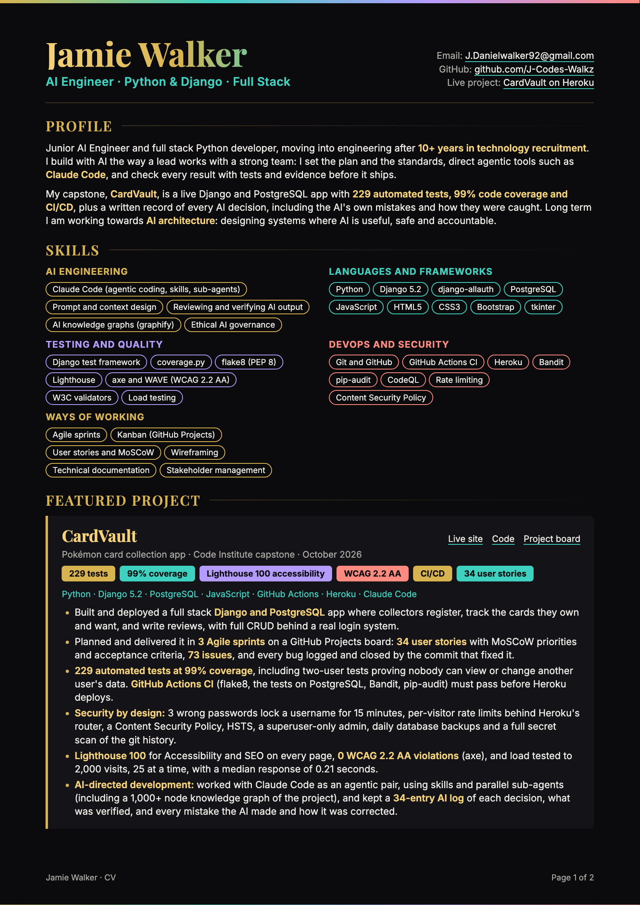

<h1 align="center">Jamie Walker</h1>

<b>AI Engineer · Python & Django · Full Stack</b>

  
  
  
  

---

**Contact:** [J.Danielwalker92@gmail.com](mailto:J.Danielwalker92@gmail.com) · [github.com/J-Codes-Walkz](https://github.com/J-Codes-Walkz) · [CardVault on Heroku](https://cardvault-0a18b8d773ca.herokuapp.com/)

## Profile

Junior AI Engineer and full stack Python developer, moving into engineering after **10+ years in technology recruitment**. I build with AI the way a lead works with a strong team: I set the plan and the standards, direct agentic tools such as **Claude Code**, and check every result with tests and evidence before it ships.

My capstone, **CardVault**, is a live Django and PostgreSQL app with **229 automated tests, 99% code coverage and CI/CD**, plus a written record of every AI decision, including the AI's own mistakes and how they were caught. Long term I am working towards **AI architecture**: designing systems where AI is useful, safe and accountable.

## Skills

- **AI engineering:** Claude Code (agentic coding, skills, sub-agents), Prompt and context design, Reviewing and verifying AI output, AI knowledge graphs (graphify), Ethical AI governance
- **Languages and frameworks:** Python, Django 5.2, django-allauth, PostgreSQL, JavaScript, HTML5, CSS3, Bootstrap, tkinter
- **Testing and quality:** Django test framework, coverage.py, flake8 (PEP 8), Lighthouse, axe and WAVE (WCAG 2.2 AA), W3C validators, Load testing
- **DevOps and security:** Git and GitHub, GitHub Actions CI, Heroku, Bandit, pip-audit, CodeQL, Rate limiting, Content Security Policy
- **Ways of working:** Agile sprints, Kanban (GitHub Projects), User stories and MoSCoW, Wireframing, Technical documentation, Stakeholder management

## Featured project

### CardVault

*Pokémon card collection app · Code Institute capstone · October 2026*  
[Live site](https://cardvault-0a18b8d773ca.herokuapp.com/) · [Code](https://github.com/J-Codes-Walkz/CardVault) · [Project board](https://github.com/users/J-Codes-Walkz/projects/5)

`Python · Django 5.2 · PostgreSQL · JavaScript · GitHub Actions · Heroku · Claude Code`

- Built and deployed a full stack **Django and PostgreSQL** app where collectors register, track the cards they own and want, and write reviews, with full CRUD behind a real login system.
- Planned and delivered it in **3 Agile sprints** on a GitHub Projects board: **34 user stories** with MoSCoW priorities and acceptance criteria, **73 issues**, and every bug logged and closed by the commit that fixed it.
- **229 automated tests at 99% coverage**, including two-user tests proving nobody can view or change another user's data. **GitHub Actions CI** (flake8, the tests on PostgreSQL, Bandit, pip-audit) must pass before Heroku deploys.
- **Security by design:** 3 wrong passwords lock a username for 15 minutes, per-visitor rate limits behind Heroku's router, a Content Security Policy, HSTS, a superuser-only admin, daily database backups and a full secret scan of the git history.
- **Lighthouse 100** for Accessibility and SEO on every page, **0 WCAG 2.2 AA violations** (axe), and load tested to 2,000 visits, 25 at a time, with a median response of 0.21 seconds.
- **AI-directed development:** worked with Claude Code as an agentic pair, using skills and parallel sub-agents (including a 1,000+ node knowledge graph of the project), and kept a **34-entry AI log** of each decision, what was verified, and every mistake the AI made and how it was corrected.

## Other projects

### Team 3 Hackathon: Active Community

*Team of 3 · September 2026 · HTML, CSS, JavaScript, Bootstrap*  
[Live site](https://j-codes-walkz.github.io/Team-3/) · [Code](https://github.com/J-Codes-Walkz/Team-3)

- A one-page site for finding fitness and community events across the UK. I built the **hero, header and footer**, the **whole modal system** (sign up, log in, about, contact, join) in JavaScript, and the **colour palette and UI styling**, working to a shared Kanban board and wireframe.

### Snake

*Solo · September 2026 · Python, tkinter*  
[Code](https://github.com/J-Codes-Walkz/python_snake)

- A desktop Snake game in **Python** with smooth movement, speed that rises with the score, pause and restart, and a **high score saved to a JSON file**, written with type hints and a single, named colour palette.

### Learning To Code

*Solo · August 2026 · HTML, CSS*  
[Live site](https://j-codes-walkz.github.io/Jay-Code-Institute-FirstProject/) · [Code](https://github.com/J-Codes-Walkz/Jay-Code-Institute-FirstProject)

- My first project: an accessible one-page guide for beginners, using semantic HTML, **Flexbox and CSS Grid**, labelled forms and a Balsamiq wireframe.

## Training

### Code Institute: Full Stack Software Engineering

*16-week intensive bootcamp · 2026*

- Built and deployed solo and team projects in HTML, CSS, JavaScript, Python and Django, with wireframes, READMEs, testing write-ups and presentations, managed on Kanban boards.

### AI learning and governance

*Ongoing*

- Ethical AI Governance coursework (Coursera) and UNESCO's Global MOOC on the Ethics of AI. I build my own learning systems and Python and JavaScript guides with Claude, Copilot and ChatGPT, using structured prompts to get reliable results.

## Career history

10+ years in technology recruitment, specialising in **backend and cloud (.NET and Azure)** engineers. I know how strong engineering teams hire, work and communicate, and I bring stakeholder management, negotiation and clear writing to every team I join.

### Accenture: Talent Acquisition Lead (fixed-term contract)

*January 2025 to June 2026*

- Led hiring campaigns across Technology, Marketing, Sales and Procurement, managing the full cycle through to offer negotiation.
- Wrote internal documentation and improved recruitment systems; trained in cybersecurity, HR policy, mental health and advanced recruitment practice.

### Aspire: Senior Consultant

*January 2024 to December 2024*

- **Top biller in Q2**, with £182,427 revenue, placing talent across Technology, Digital, Media, Marketing, Research and Sales.

### Harvey Nash: Delivery Team Lead

*January 2023 to January 2024*

- **Designed and led a new Apprenticeship Academy**: managed apprentices' training, development plans and performance reviews, and delivered into key accounts.

### Spinks (Harvey Nash Group): Technology Consultant

*August 2019 to December 2022*

- Recruited software engineers, designers and analysts; delivered **Spinks-on-Site** solutions worth £60,000+ and supported inclusion and diversity events.

## Education

- UNESCO: Global MOOC on the Ethics of AI
- University of Wolverhampton: BSc (Hons) Music Technology, 2:1
- Birmingham City University: HND Popular Music and Practice
- SCCB: BTEC National Diploma
- A Levels: Music, Multimedia
